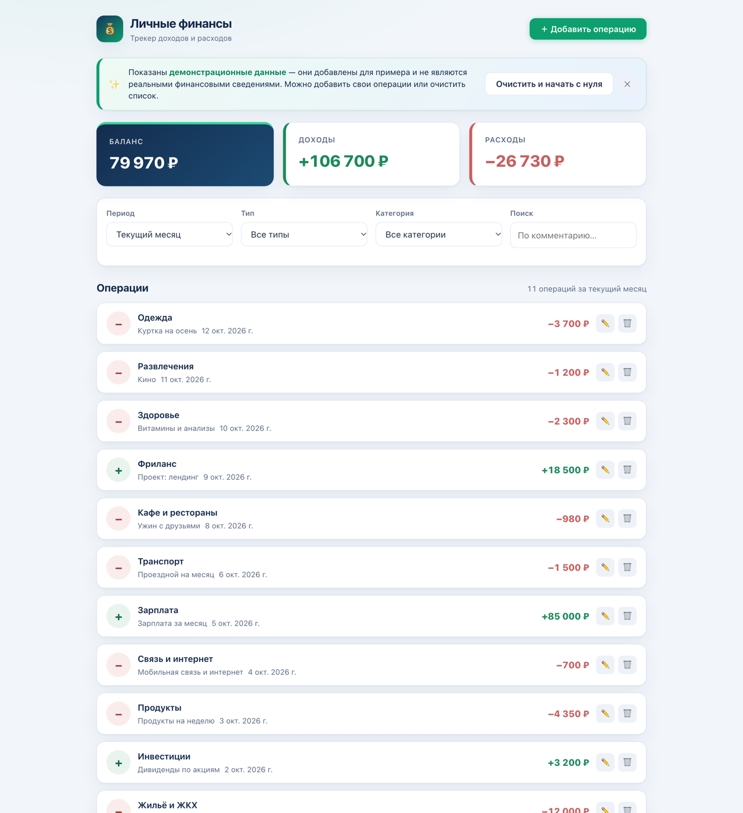
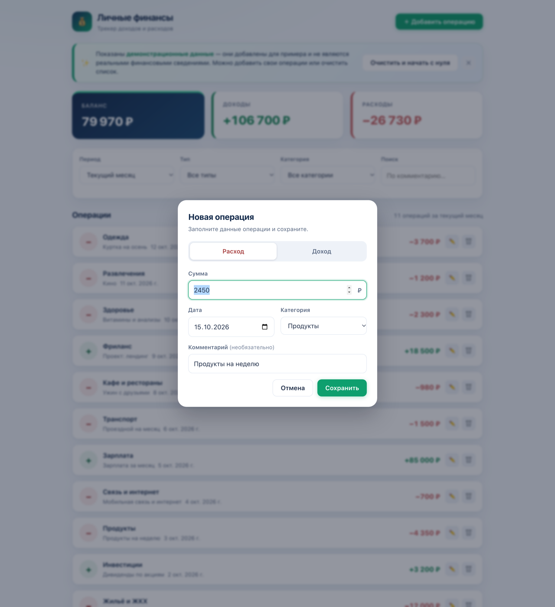
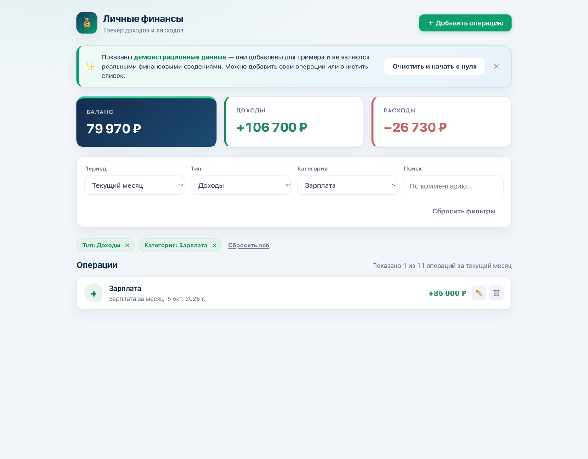
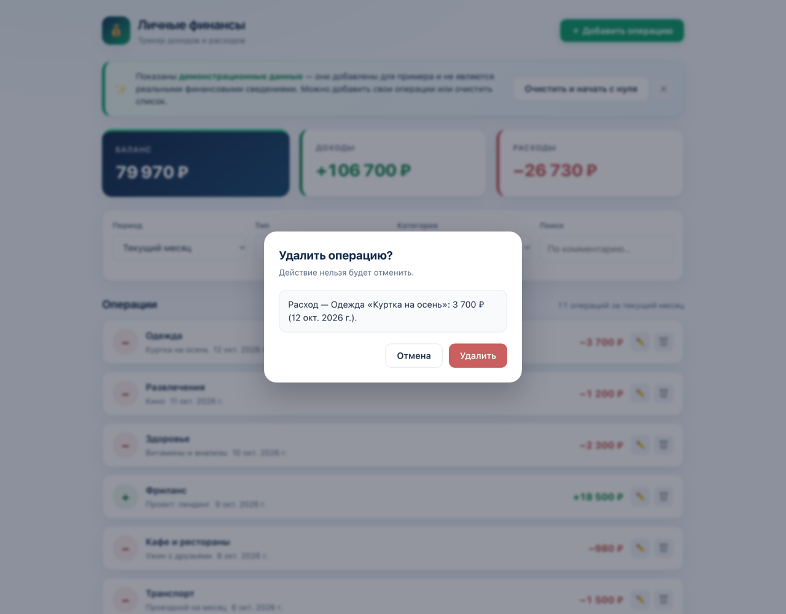
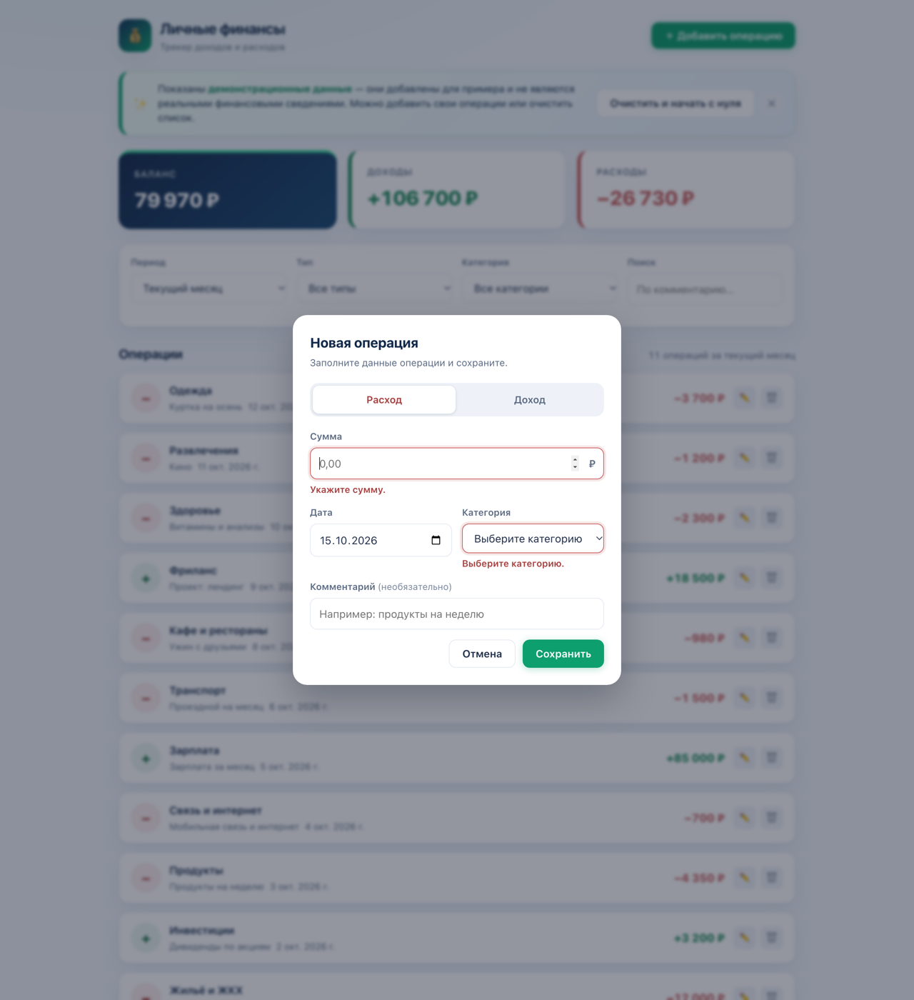
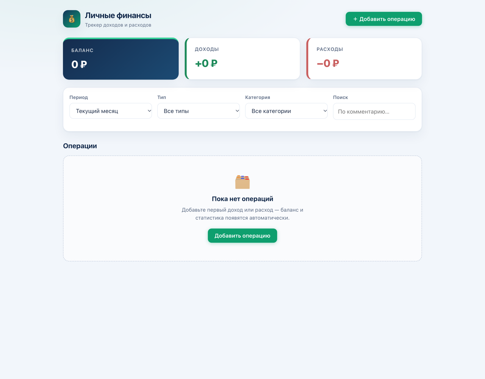
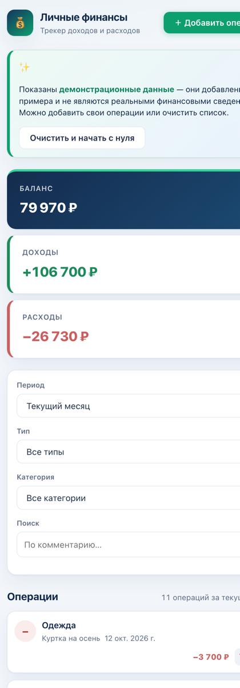

# 💰 Личные финансы — трекер доходов и расходов

Небольшой веб-трекер личных финансов: доходы, расходы, автоматический баланс, фильтры и поиск.
Работает как статическая страница — без сборщика, без зависимостей и без сервера. Достаточно открыть
`index.html` в браузере.



## Зачем этот проект

Демонстрационный frontend-проект: он показывает, как собрать полноценное интерактивное приложение
на чистом HTML, CSS и JavaScript и организовать хранение данных на стороне браузера.

Ключевые преимущества:

- **Ничего не нужно устанавливать** — нет сборки, npm-зависимостей и backend-сервиса.
- **Работает офлайн** — вся логика и данные находятся в браузере.
- **Сразу видно результат** — демонстрационные операции появляются при первом запуске.
- **Понятный код** — три файла: `index.html`, `styles.css`, `script.js`.
- **Адаптивная вёрстка** — интерфейс корректно выглядит и на десктопе, и на телефоне.

## Возможности

### Учёт операций

- Доходы и расходы в одном списке.
- Добавление операции: сумма, дата, категория и необязательный комментарий.
- Редактирование любой операции — запись обновляется на месте, дубликаты не создаются.
- Удаление операции с диалогом подтверждения.
- Очистка всего списка одной кнопкой (тоже через подтверждение).

### Итоги и пересчёт

- Карточки «Баланс», «Доходы» и «Расходы» пересчитываются автоматически после любого изменения.
- Итоги считаются за выбранный период; отрицательный баланс подсвечивается отдельным цветом.
- Список отсортирован по дате: сначала новые операции.

### Фильтрация и поиск

- Период: «Текущий месяц» (по умолчанию) или «Все операции».
- Тип: все, только расходы или только доходы.
- Категория: список категорий зависит от выбранного типа.
- Поиск по тексту комментария (категория и сумма в поиск не входят).
- Активные фильтры отображаются в виде чипов — каждый можно убрать по отдельности или сбросить все сразу.
- Счётчик показывает, сколько операций попало в выборку, например «Показано 3 из 11 операций за текущий месяц».

### Форма и подсказки

- Проверка обязательных полей: сумма должна быть положительным числом (до двух знаков после запятой,
  разделитель — запятая или точка), дата и категория обязательны.
- Понятные тексты ошибок прямо под полями и подсветка проблемного поля.
- Закрытие модальных окон кнопкой «Отмена», кликом по затемнению или клавишей `Esc`.
- Демонстрационные данные при первом запуске и отдельное пустое состояние, если операций нет.
- Состояние «Ничего не найдено», если под текущие фильтры не подходит ни одна операция.

### Интерфейс

- Светлая минималистичная тема, единые карточки, кнопки и модальные окна.
- Адаптивная вёрстка: контрольные точки на 900, 720 и 520 px.
- Базовая доступность: `role="dialog"`, `aria-modal`, `aria-checked`, `aria-invalid`, автоматический
  фокус на первом поле и закрытие по `Esc`.

## Технологии

| Технология | Как используется |
| --- | --- |
| HTML5 | Разметка интерфейса и семантические атрибуты доступности |
| CSS3 | Переменные, grid и flex, анимация модальных окон, адаптивные медиазапросы |
| Vanilla JavaScript | Вся логика приложения без фреймворков и библиотек |
| `localStorage` | Единственное хранилище данных приложения |

Никаких внешних зависимостей, транспайлеров или сборщика в проекте нет.

## Запуск локально

**Вариант 1. Просто открыть файл**

Скачайте проект и откройте `index.html` в браузере (двойной клик по файлу).

**Вариант 2. Локальный сервер**

Если удобнее работать через `http://`, запустите в папке проекта:

```bash
python3 -m http.server 8000
```

и откройте <http://localhost:8000>.

Обратите внимание: у `file://` и `http://localhost:8000` **разные origin**, поэтому список операций
в этих двух случаях не общий.

## Хранение данных

Все данные лежат в `localStorage` браузера — сервера, базы данных и сетевых запросов у приложения нет.

| Ключ | Содержимое |
| --- | --- |
| `expense-tracker.operations.v1` | Массив операций: `id`, `type`, `amount`, `category`, `date`, `comment`, `createdAt`, `updatedAt` |
| `expense-tracker.demo.v1` | Флаг `'1'` — показываются демонстрационные данные |

Запись выполняется после каждого изменения; при загрузке данные читаются и фильтруются — некорректные
записи отбрасываются.

## Ограничения

- **Нет backend, базы данных, авторизации и синхронизации** между устройствами или браузерами.
- Данные привязаны к текущему браузеру и origin (протокол + домен + порт). При смене домена, порта
  или переходе с `file://` на `http://localhost` ранее сохранённые операции могут не отобразиться.
- Очистка данных браузера, режим инкогнито, переустановка или смена браузера — и операции будут
  потеряны. Резервное копирование и восстановление не предусмотрены.
- Объём `localStorage` ограничен браузером (обычно несколько мегабайт). Если запись не удалась —
  например, из-за переполнения или запрета хранилища в настройках, — приложение не покажет предупреждение,
  а изменения останутся только до перезагрузки страницы.
- Валюта одна — российский рубль; суммы форматируются для русской локали (`ru-RU`) и выводятся с символом `₽`.
  Переключения валют и курсов нет.
- Не реализованы: графики и диаграммы, экспорт и импорт данных, редактирование списка категорий,
  несколько счетов.
- Интерфейс только на русском языке — переключения языка нет.
- Данные не шифруются, пароля на приложение нет.

## Скриншоты

### Главный экран

Итоги за период, фильтры, поиск и список операций.


### Добавление операции

Модальное окно новой операции: тип, сумма, дата, категория и комментарий.



### Активные фильтры

Выбран тип и категория — условия видны в виде чипов, счётчик показывает размер выборки.



### Подтверждение удаления

Перед удалением приложение показывает, какая именно операция будет удалена.



### Ошибки валидации

Проверка формы: сообщения под полями и подсветка проблемных полей.



### Пустое состояние

Если операций нет, показывается подсказка и кнопка добавления первой записи.



### Мобильная версия

Адаптивная вёрстка на узком экране.



## Структура проекта

```
tracker3/
├── index.html            # Разметка интерфейса
├── styles.css            # Стили и адаптивность
├── script.js             # Логика приложения и работа с localStorage
├── docs/
│   └── screenshots/      # Скриншоты для документации
└── README.md
```

## Статус проекта

Самостоятельный завершённый frontend-проект: заявленные возможности реализованы и проверены вручную
в браузере. Автоматические тесты и CI не настроены. Проект развивается по мере необходимости —
предложения и замечания можно оставить в Issues репозитория.
